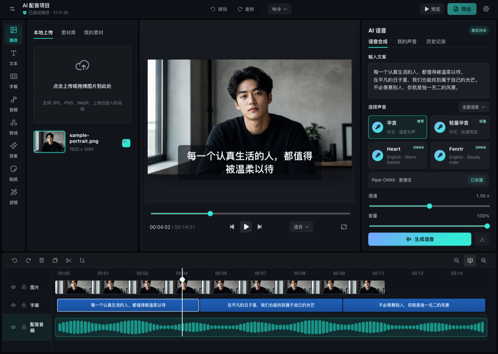

# Timeline Studio — ブラウザ AI 動画エディター

[English](README.md) | [中文](README.zh-CN.md) | **日本語** | [한국어](README.ko.md) | [Español](README.es.md) | [Français](README.fr.md) | [Deutsch](README.de.md) | [Português](README.pt-BR.md) | [ไทย](README.th.md) | [Tiếng Việt](README.vi.md) | [Русский](README.ru.md)

[](https://skills.sh/MartinDelophy/ai-video-editor)
[](CONTRIBUTING.md) [](https://linux.do)

## ディープシンセシス技術の責任ある利用

本ツールはディープシンセシス技術を使用しており、技術研究および学習のみを目的としています。

利用者は、以下の事項を必ず遵守してください。

- 本人、または適法な許可を得た人物の顔画像・動画のみを使用すること。
- 違法、権利侵害、虚偽、または誤解を招くコンテンツを作成・拡散しないこと。
- 生成コンテンツを実際の映像として提示せず、本人の同意なく他人になりすまさないこと。

上記の要件に違反したことにより生じる一切の法的責任は、利用者自身が負うものとします。

## プロジェクト更新

- **2026-10-30** — プレビュー動画の右クリックメニューに、画面配置、フィット・塗りつぶし、子画面の開始・終了位置合わせ、参照フレームによる手動同期を追加。取り消しとトラックロックに対応。
- **2026-10-25** — Anna のスマートパネルに公式クラウド音楽生成を追加。モデル対応の歌詞・長さ・形式を表示し、タスク復旧、重複送信防止、試聴、マイ素材への保存に対応。
- **2026-10-20** — Anna動画設定を単一のスクロール領域に統一し、内容が収まらない場合はドラッグ可能な細いバーを表示します。 Annaで生成した動画は保存後に既存のプレビューで再生でき、閉じても編集画面を維持します。 ストーリーボードの右クリックメニューにプレビュー、ダウンロード、後続ノード作成、削除、全体表示を追加。 無限キャンバスも同じメニューを使用し、空白領域から元に戻す・やり直しができます。 トラックパッド操作は開始時の対象を維持し、フレーム単位で表示を更新して操作終了後に保存します。
- **2026-10-19** — 無限キャンバスとストーリーボードで、ノード・接続・指示・素材を含むプロジェクトの保存、読み込み、Annaクラウドへのバックアップとコピー復元に対応。両画面のトラックパッド操作も統一しました。 AI透かし除去の比較プレビューが終了後に再生できない問題を修正しました。
- **2026-10-18** — 再生に同期するキャラクター動作・カメラトラックと、時間編集・クリック移動に対応した脚本カルーセルを追加。 白模の対話にChatCutを再利用し、会話履歴、下書き復元、オブジェクト参照、変更確認を統一。 ストーリーボードの既定モデルを GPT Image 2（fal）に変更。会話モデルのルーティングと長い物語の文脈保持を修正し、実際のモデル切り替え応答を確認しました。開始・終了フレーム動画は Anna の API 拡張待ちです。仕様案: docs/storyboard-anna-video-contract.md。 ワークフローの読み込みエラーを編集画面から分離し、再試行・戻る操作とAnna草稿更新時の互換リソース保持に対応。 無限キャンバスの出力ポートに方向付き接続線、互換入力の強調表示、次ノードの作成と接続を一度に取り消せるメニューを追加しました。 キャンバスのチャットで @ によるノード検索と参照に対応し、削除可能なタグと明示的なノード ID を使用します。

計画中の作業は [Roadmap](ROADMAP.md)、公開済みの変更は [Releases](https://github.com/MartinDelophy/ai-video-editor/releases)、個別タスクは [Issues](https://github.com/MartinDelophy/ai-video-editor/issues) を参照してください。

## 何を制作できますか？

再現可能なビフォー・アフター例と編集レシピをご覧ください：

→ [AI Video Editing Skills Handbook](https://github.com/MartinDelophy/timeline-studio-handbook)

<p align="center">
  <a href="https://trendshift.io/repositories/77422?utm_source=trendshift-badge&amp;utm_medium=badge&amp;utm_campaign=badge-trendshift-77422" target="_blank" rel="noopener noreferrer"></a>
  <a href="https://trendshift.io/repositories/77422?utm_source=trendshift-badge&amp;utm_medium=badge&amp;utm_campaign=badge-trendshift-77422" target="_blank" rel="noopener noreferrer"></a>
</p>

Timeline Studio はブラウザで動作するローカルファーストの AI 動画エディターです。CapCut のようなマルチトラックタイムラインに、AI 音声、字幕自動生成、画像解析、トーキングアバター、決定論的なオフライン書き出しを統合しています。

[エディターを開く](https://video-editor.ai-creator.top/) · [デモを見る](https://www.youtube.com/watch?v=chdRPG2ndMs) · [Hugging Face Space](https://huggingface.co/spaces/haixin/timeline-studio)



## 主な機能

- Piper/VITS ONNX と Kokoro 82M による多言語音声。
- Stable Audio 3 Small Q4 ONNX と WebGPU によるローカル AI 音楽生成。自由入力プロンプトの翻訳、30/60/90/120 秒、波形解析による長尺ループ、モデルの永続キャッシュ、マイ素材への自動追加に対応。
- Whisper small q8 ONNX による字幕自動生成。
- YOLOS tiny と MODNet によるスマートフレーミング。
- ボーカル分離、JoyVASA と LivePortrait によるアバター生成。
- オーバーレイ、マスク、フィルター、アニメーション、キーフレーム対応のマルチトラック編集。
- WebCodecs と音声ミックスを使ったブラウザ内 MP4/WebM 書き出し。
- インストール可能な PWA、モデルのローカルキャッシュ、`.timeline` プロジェクト。

## AI 音声デモ

https://github.com/user-attachments/assets/304a744e-d620-4380-9c17-19af3726f5a4

## Agent Skill

このリポジトリには、編集可能な動画タイムラインの計画、操作、検証を行う [`edit-timeline-studio`](skills/edit-timeline-studio/SKILL.md) Agent Skill が含まれています。GitHub CLI 2.90.0 以降でインストールできます。

[skills.sh](https://skills.sh/MartinDelophy/ai-video-editor) からインストールする場合は Node.js 22.20.0 以降が必要です。

```bash
npx skills add MartinDelophy/ai-video-editor --skill edit-timeline-studio
```

```bash
# Claude Code
gh skill install MartinDelophy/ai-video-editor edit-timeline-studio --agent claude-code --scope user

# Codex
gh skill install MartinDelophy/ai-video-editor edit-timeline-studio --agent codex --scope user
```

検証済みのリリースに固定するには `--pin v1.0.8` を追加します。インストール前の確認には `gh skill preview MartinDelophy/ai-video-editor edit-timeline-studio` を使用してください。

## ロードマップ

- **現在：** 決定論的オフライン書き出しの安定化、タイムライン編集の信頼性向上、ブラウザ E2E テストの拡充。
- **次：** ヘッドレス描画とブラウザ出力の対応範囲を広げ、確認可能な WebMCP 編集コマンドと共有しやすいプロジェクトテンプレートを充実させます。
- **将来：** 共同レビュー、プラグイン拡張基盤、ローカルで検証済みの AI モデルの追加。

優先順位は [GitHub Discussions](https://github.com/MartinDelophy/ai-video-editor/discussions) で話し合います。

## コントリビューター募集

ブラウザメディア、WebCodecs、WebGPU/ONNX、タイムライン UX、翻訳、テスト、ドキュメントへの協力を歓迎します。再現可能な不具合は [Issues](https://github.com/MartinDelophy/ai-video-editor/issues) へ、提案や作品は [Discussions](https://github.com/MartinDelophy/ai-video-editor/discussions) へお寄せください。小さな修正、テスト、翻訳、サンプルも歓迎します。

## クイックスタート

Node.js 20+ と最新の Chromium ブラウザが必要です。WebGPU を推奨します。

```bash
git clone https://github.com/MartinDelophy/ai-video-editor.git
cd ai-video-editor
npm install
npm run dev
```

## 検証

```bash
npm run build
npm run check
```

## サポートとフィードバック

このプロジェクトが役に立ったら、ぜひ ⭐ Star をお願いします。問題が発生した場合は、[Issue を作成してください](https://github.com/MartinDelophy/ai-video-editor/issues)。

質問やフィードバックの共有、ほかのユーザーやコントリビューターとの交流には、[Discord コミュニティ](https://discord.gg/uq2uvUTBr)へご参加ください。

## ライセンス

[MIT](LICENSE)
