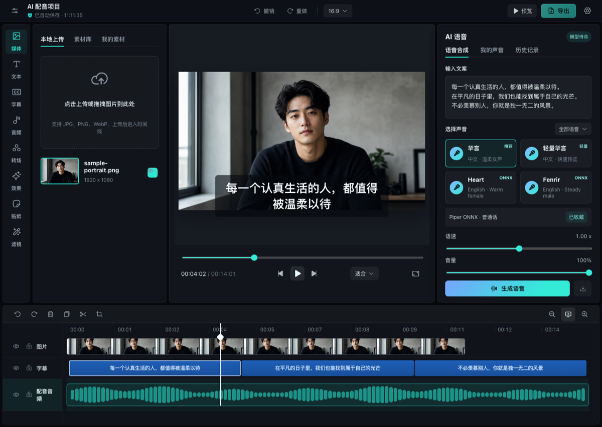

# Timeline Studio — โปรแกรมตัดต่อวิดีโอ AI บนเบราว์เซอร์

[English](README.md) | [中文](README.zh-CN.md) | [日本語](README.ja.md) | [한국어](README.ko.md) | [Español](README.es.md) | [Français](README.fr.md) | [Deutsch](README.de.md) | [Português](README.pt-BR.md) | **ไทย** | [Tiếng Việt](README.vi.md) | [Русский](README.ru.md)

[](https://skills.sh/MartinDelophy/ai-video-editor)
[](CONTRIBUTING.md) [](https://linux.do)

## การใช้เทคโนโลยีสังเคราะห์เชิงลึกอย่างรับผิดชอบ

เครื่องมือนี้ใช้เทคโนโลยีสังเคราะห์เชิงลึกและมีไว้เพื่อการวิจัยทางเทคนิคและการเรียนรู้เท่านั้น

ผู้ใช้ต้องตรวจสอบให้แน่ใจว่า:

- ใช้เฉพาะภาพหรือวิดีโอใบหน้าของตนเอง หรือของบุคคลที่ได้ให้การอนุญาตอย่างถูกต้องตามกฎหมายแล้ว
- ไม่สร้างหรือเผยแพร่เนื้อหาที่ผิดกฎหมาย ละเมิดสิทธิ เป็นเท็จ หรือทำให้เข้าใจผิด
- ไม่นำเสนอเนื้อหาที่สร้างขึ้นว่าเป็นภาพจริง และไม่สวมรอยเป็นบุคคลอื่นโดยไม่ได้รับความยินยอม

ผู้ใช้ต้องรับผิดชอบแต่เพียงผู้เดียวต่อความรับผิดทางกฎหมายใด ๆ ที่เกิดจากการฝ่าฝืนข้อกำหนดเหล่านี้

## ข่าวสารโครงการ

- **2026-10-19** — แคนวาสและสตอรีบอร์ดรองรับดาวน์โหลดและนำเข้าโปรเจกต์ครบชุด รวมถึงสำรองบน Anna และกู้คืนเป็นสำเนาที่แก้ไขได้ พร้อมโหนด การเชื่อมต่อ คำสั่ง และสื่อ ทั้งสองหน้าจอใช้การจัดการท่าทางแทร็กแพดร่วมกัน แก้ไขการเล่นซ้ำหลังวิดีโอเปรียบเทียบการลบลายน้ำด้วย AI เล่นจบ
- **2026-10-18** — เพิ่มแทร็กการเคลื่อนไหวตัวละครและกล้องที่ตรงกับการเล่น พร้อมข้อความบทที่เลื่อนตามและแก้ไขเวลาได้ บทสนทนา 3D ใช้ ChatCut ร่วมกัน พร้อมประวัติ กู้คืนฉบับร่าง อ้างอิงวัตถุ และตรวจสอบการเปลี่ยนแปลง สตอรีบอร์ดใช้ GPT Image 2 (fal) เป็นค่าเริ่มต้น แก้ไขการเลือกเส้นทางโมเดลสนทนาและการเก็บบริบทเรื่องยาว พร้อมตรวจสอบผลตอบกลับจากการสลับโมเดลจริง วิดีโอที่กำหนดเฟรมเริ่มต้นและสิ้นสุดยังรอ Anna เพิ่ม API: docs/storyboard-anna-video-contract.md แยกข้อผิดพลาดการโหลดเวิร์กโฟลว์จากตัวแก้ไข พร้อมลองใหม่ กลับ และรองรับทรัพยากรรุ่นก่อนเมื่ออัปเดต Anna แคนวาสไม่จำกัดเพิ่มเส้นเชื่อมบอกทิศทาง การเน้นอินพุตที่เข้ากันได้ และเมนูสร้างพร้อมเชื่อมโหนดถัดไปในขั้นตอนเดียวที่เลิกทำได้ แชตแคนวาสรองรับการค้นหาและอ้างอิงโหนดด้วย @ พร้อมแท็กที่ลบได้และ ID โหนดที่ชัดเจน
- **2026-10-17** — เพิ่มผืนงานไม่สิ้นสุดพร้อมโหนดแบบระบุชนิด การแก้ไข Anna ที่ตรวจสอบก่อนใช้ ตัวเชื่อมต่อจริง เสียงพากย์และเพลงในเครื่อง เวอร์ชันผลลัพธ์ การตรวจสอบงานวิดีโอต่อ และการกู้คืนสื่อกับผืนงานในเบราว์เซอร์แยกตามบัญชีและโครงการ สื่อที่สร้างจะอยู่ในสื่อของฉันและสร้างเมื่อผู้ใช้สั่งเท่านั้น ภาพอ้างอิงภายในสองภาพจะแนบเฉพาะตอนสร้าง ไม่แสดงในสื่อ รายการ @ หรือโหนด
- **2026-10-17** — เพิ่มการประมวลผลเสียงในเบราว์เซอร์ด้วย RNNoise, DeepFilterNet3, EQ, การบีบอัด เกน และลิมิตเตอร์ พร้อมฟังตัวอย่าง ใช้งาน และคืนเสียงต้นฉบับ ปรับปรุงแผงเสียงต้นฉบับ การจัดแนวและเน้นคำในคำบรรยาย ฟอนต์หลายภาษา การแก้ไขแทร็กที่เชื่อมโยง และการเล่นตรงรอยต่อคลิป Anna เพิ่มเสียงบรรยายบนคลาวด์ตามแค็ตตาล็อก บันทึกในสื่อของฉัน และการป้อนเสียง ChatCut โดยต้องมีสิทธิ์แอปและไมโครโฟน รวมเสียง Anna ในการ์ดเลือกเสียงและปุ่มสร้างเดิม พร้อมอวตารเสมือนใหม่สามแบบ คำบรรยายอัตโนมัติ Anna และการถอดเสียง ChatCut ใช้ Anna STT ร่วมกัน พร้อมรักษาการเชื่อมเสียงและภาพ ChatCut รองรับสไตล์คำบรรยาย การย้ายแบบเชื่อมโยง สติกเกอร์ เสียงเชิงพื้นที่ และประมวลผลเสียงในเครื่อง โดย Anna บรรยายด้วย TTS ที่เลือกไว้ เลือกข้อความเพื่อเน้นแยกตามคำบรรยาย พร้อมเลือกสีและล้างการเน้นได้ การ์ดเสียง Anna เล่นตัวอย่างเสียงทางการที่ตรงกันได้ทันที และลบปุ่มคำบรรยายที่ซ้ำกันแล้ว Anna เพิ่มผู้ช่วยเสียงด้านบนสำหรับตรวจความสามารถ เปิดแผง และตัดต่อผ่าน ChatCut พร้อมปิดเสียง ขัดจังหวะ และยืนยันการสร้างสื่อ คำบรรยายอัตโนมัติประมวลผลทุกคลิปตามค่าเริ่มต้น และเลือกคลิปเดียวได้ เพิ่มการลดเสียงอัตโนมัติสำหรับเสียงต้นฉบับ เสียงพูด และเพลง โดยปิดเป็นค่าเริ่มต้น ใช้ Silero ในเครื่องและเส้นระดับเสียงเดียวกันสำหรับตัวอย่างและส่งออก การโทร Anna ใช้แถบคลื่นเสียงด้านบนพร้อมปิดเสียง ขัดจังหวะ และวางสาย โดยไม่บังภาพ การเปลี่ยนคลิปจะคงเฟรมเดิมไว้จนกว่าเฟรมถัดไปพร้อมแสดง เพื่อป้องกันภาพว่างกะพริบ การลดเสียงอัตโนมัติแสดงขั้นตอนการโหลดและเส้นระดับเสียงจริงบนไทม์ไลน์ เพิ่มการปรับปรุงเสียงพูด 3 ระดับ พร้อมเปรียบเทียบและคืนเสียงต้นฉบับ การลดเสียงใช้โมเดลที่โหลดไว้ซ้ำและแสดงความคืบหน้าตั้งแต่ 0% คำทักทายและคำสั่งหน้าจอที่ชัดเจนตอบสนองในเครื่อง ส่วนการตัดต่อซับซ้อนยังตรวจสอบตามเดิม เวิร์กโฟลว์เพิ่มต้นแบบ 3D ที่แก้ไขได้ พร้อมการแปลง ช็อตกล้อง เล่น เลิกทำ และตรวจสอบการแก้ไข Anna ก่อนใช้ ส่วนเสียงตัวละครยังไม่รองรับ เพิ่มสตอรีบอร์ดพร้อมช่อง ChatCut การอ้างอิง @ ผืนผ้าใบโหนดที่เริ่มว่าง การเลือกโมเดล และการกู้คืนแยกตามบัญชีและโปรเจกต์ ทั้ง 16 ช่องเป็นภาพเดียว ส่วนวิดีโอแบบกำหนดเฟรมสุดท้ายยังรอ API ของ Anna รองรับ
- **2026-10-12** — ขณะเล่นวิดีโอยาว ระบบพักการปรับภาพย่อเบื้องหลังและวาดเฟรมตรงหัวเล่นโดยไม่เข้ารหัส JPEG เมื่อเล่นต่อจะใช้ตำแหน่งค้นหาล่าสุดก่อน เตรียมเสียง AAC โดยคัดลอกแพ็กเก็ตเสียง ไม่เข้ารหัสใหม่หรือคัดลอกวิดีโอทั้งไฟล์เข้า WASM พร้อมคงเอฟเฟกต์และการตั้งค่าส่งออกเดิม การส่งออกให้ความสำคัญกับตัวเข้ารหัสฮาร์ดแวร์ที่รองรับ และส่งเฟรมขนาดต้นฉบับที่เข้าเงื่อนไขไปประกอบโดยตรง ส่วนการแปลงและเอฟเฟกต์ยังใช้เส้นทางวาดเดิม การเข้ารหัสเสียงและการประกอบเฟรมถัดไปทำงานควบคู่กับการส่งเฟรมวิดีโอ โดยจำกัดขนาดคิว

ดูงานที่วางแผนไว้ใน [Roadmap](ROADMAP.md) การเปลี่ยนแปลงที่เผยแพร่แล้วใน [Releases](https://github.com/MartinDelophy/ai-video-editor/releases) และงานหรือข้อผิดพลาดใน [Issues](https://github.com/MartinDelophy/ai-video-editor/issues)

## สร้างอะไรได้บ้าง?

สำรวจตัวอย่างก่อน–หลังที่ทำซ้ำได้และสูตรการตัดต่อ:

→ [AI Video Editing Skills Handbook](https://github.com/MartinDelophy/timeline-studio-handbook)

<p align="center">
  <a href="https://trendshift.io/repositories/77422?utm_source=trendshift-badge&amp;utm_medium=badge&amp;utm_campaign=badge-trendshift-77422" target="_blank" rel="noopener noreferrer"></a>
  <a href="https://trendshift.io/repositories/77422?utm_source=trendshift-badge&amp;utm_medium=badge&amp;utm_campaign=badge-trendshift-77422" target="_blank" rel="noopener noreferrer"></a>
</p>

Timeline Studio คือโปรแกรมตัดต่อวิดีโอ AI แบบเน้นการทำงานในเครื่อง ซึ่งทำงานบนเบราว์เซอร์ รวมไทม์ไลน์หลายแทร็กแบบ CapCut เข้ากับเสียงพากย์ AI คำบรรยายอัตโนมัติ เครื่องมือวิเคราะห์ภาพ อวตารพูดได้ และการส่งออกแบบออฟไลน์ที่ให้ผลแน่นอน

[เปิดโปรแกรมตัดต่อ](https://video-editor.ai-creator.top/) · [ชมเดโม](https://www.youtube.com/watch?v=chdRPG2ndMs) · [Hugging Face Space](https://huggingface.co/spaces/haixin/timeline-studio)



## ความสามารถหลัก

- เสียงพากย์หลายภาษาด้วย Piper/VITS ONNX และ Kokoro 82M
- สร้างเพลง AI ในเครื่องด้วย Stable Audio 3 Small Q4 ONNX ผ่าน WebGPU รองรับการแปลพรอมต์อิสระ ระยะเวลา 30/60/90/120 วินาที การวนเพลงยาวโดยวิเคราะห์รูปคลื่น แคชโมเดลแบบถาวร และเพิ่มลงในสินทรัพย์ของฉันโดยอัตโนมัติ
- คำบรรยายอัตโนมัติด้วย Whisper small q8 ONNX
- การจัดเฟรมอัจฉริยะด้วย YOLOS tiny และ MODNet
- แยกเสียงร้องและดนตรี พร้อมอวตาร JoyVASA และ LivePortrait
- การตัดต่อหลายแทร็ก พร้อมโอเวอร์เลย์ มาสก์ ฟิลเตอร์ แอนิเมชัน และคีย์เฟรม
- ส่งออก MP4/WebM ในเบราว์เซอร์ด้วย WebCodecs และการมิกซ์เสียง
- PWA ที่ติดตั้งได้ แคชโมเดลในเครื่อง และโปรเจกต์ `.timeline`

## เดโมเสียงพากย์ AI

https://github.com/user-attachments/assets/304a744e-d620-4380-9c17-19af3726f5a4

## Agent Skill

รีโพซิทอรีนี้มี Agent Skill [`edit-timeline-studio`](skills/edit-timeline-studio/SKILL.md) สำหรับวางแผน ดำเนินการ และตรวจสอบไทม์ไลน์วิดีโอที่ยังแก้ไขต่อได้ ติดตั้งด้วย GitHub CLI 2.90.0 ขึ้นไป

การติดตั้งผ่าน [skills.sh](https://skills.sh/MartinDelophy/ai-video-editor) ต้องใช้ Node.js 22.20.0 ขึ้นไป

```bash
npx skills add MartinDelophy/ai-video-editor --skill edit-timeline-studio
```

```bash
# Claude Code
gh skill install MartinDelophy/ai-video-editor edit-timeline-studio --agent claude-code --scope user

# Codex
gh skill install MartinDelophy/ai-video-editor edit-timeline-studio --agent codex --scope user
```

เพิ่ม `--pin v1.0.8` เพื่อติดตั้งรุ่นที่ผ่านการตรวจสอบแทนการติดตามรีลีสล่าสุด และตรวจสอบเนื้อหาก่อนติดตั้งได้ด้วย `gh skill preview MartinDelophy/ai-video-editor edit-timeline-studio`

## แผนพัฒนา

- **ขณะนี้:** เพิ่มความเสถียรของการส่งออกออฟไลน์แบบกำหนดผลลัพธ์ได้ ปรับปรุงความน่าเชื่อถือของไทม์ไลน์ และเพิ่มการทดสอบแบบ end-to-end ในเบราว์เซอร์
- **ขั้นถัดไป:** ขยายความสามารถเรนเดอร์แบบ headless ให้ตรงกับเบราว์เซอร์ เพิ่มคำสั่ง WebMCP ที่ตรวจสอบได้ และปรับปรุงการแชร์เทมเพลตโปรเจกต์
- **อนาคต:** เพิ่มการตรวจทานร่วมกัน ระบบส่วนขยาย และโมเดล AI ที่ผ่านการตรวจสอบในเครื่องเพิ่มเติม

ร่วมกำหนดลำดับความสำคัญได้ใน [GitHub Discussions](https://github.com/MartinDelophy/ai-video-editor/discussions)

## ต้องการผู้ช่วยพัฒนา

ยินดีรับความช่วยเหลือด้านสื่อบนเบราว์เซอร์ WebCodecs, WebGPU/ONNX, UX ของไทม์ไลน์ การแปล การทดสอบ และเอกสาร โปรดแจ้งบั๊กที่ทำซ้ำได้ใน [Issues](https://github.com/MartinDelophy/ai-video-editor/issues) แบ่งปันแนวคิดใน [Discussions](https://github.com/MartinDelophy/ai-video-editor/discussions) หรือส่งการแก้ไข การทดสอบ คำแปล และตัวอย่างที่มีขอบเขตชัดเจน

## เริ่มต้นใช้งาน

ต้องใช้ Node.js 20+ และเบราว์เซอร์ Chromium รุ่นใหม่ แนะนำให้ใช้ WebGPU

```bash
git clone https://github.com/MartinDelophy/ai-video-editor.git
cd ai-video-editor
npm install
npm run dev
```

## การตรวจสอบ

```bash
npm run build
npm run check
```

## การสนับสนุนและข้อเสนอแนะ

หากโปรเจกต์นี้มีประโยชน์กับคุณ โปรดกด ⭐ Star หากพบปัญหา โปรด[เปิด Issue](https://github.com/MartinDelophy/ai-video-editor/issues)

เข้าร่วม[ชุมชน Discord](https://discord.gg/uq2uvUTBr) ของเราเพื่อสอบถาม แบ่งปันความคิดเห็น และพูดคุยกับผู้ใช้และผู้ร่วมพัฒนาคนอื่น ๆ

## สัญญาอนุญาต

[MIT](LICENSE)
